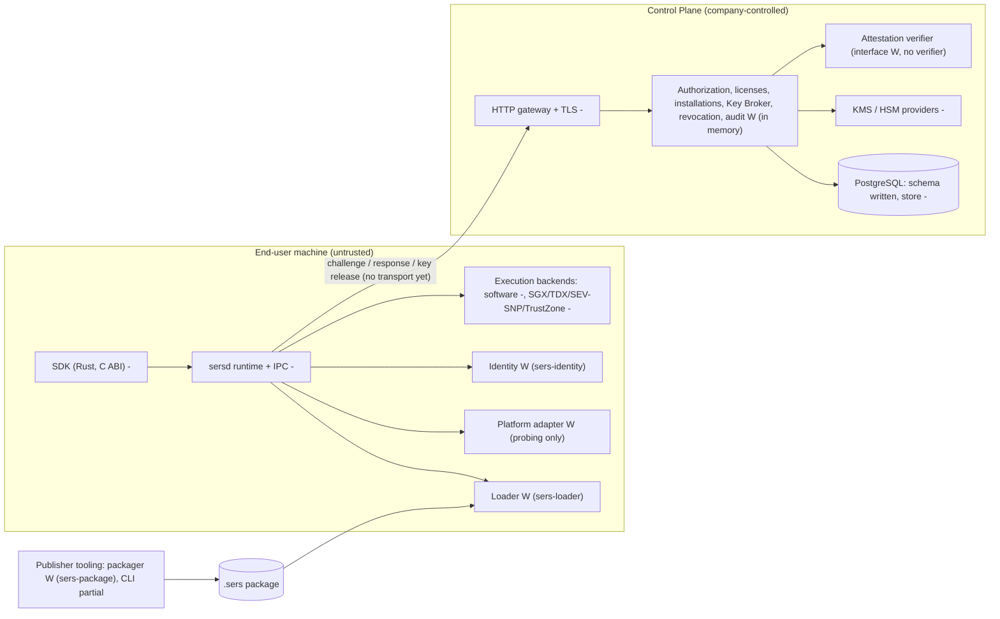

# Architecture

Status legend: **W** = implemented and compiled/tested on Windows x64 (see `PROGRESS.md`); **-** = not implemented.

## Crates

| Crate | Role | Status |
|---|---|---|
| `sers-core` | errors, validated ids, hex newtypes, capabilities, policy decision | W |
| `sers-crypto` | SHA-256, Ed25519, X25519, HKDF, AES-256-GCM, zeroizing secrets | W |
| `sers-protocol` | v1 messages, codec, challenge authority, authorization token, key release | W |
| `sers-identity` | installation identity, registration proof, file key store | W |
| `sers-package` | `.sers` format, builder, reader, envelope encryption | W |
| `sers-loader` | trust store, anti-downgrade, revocation, placement policy | W |
| `sers-platform` | platform probing and backend inventory (no backend implemented) | W |
| `sers-controlplane` | authorization logic, Key Broker, revocation, audit (in-memory) | W |
| `sers-cli` | backend detect, safe package inspection, bounded package building | partial |
| `sers-runtime`, `sers-sdk`, `sers-integrity`, backends, gateway, dashboard | - | - |

Differences from the specified layout: the Control Plane services are modules of one crate (ADR 0003);
integrity (hash list) lives in `sers-package` (ADR 0001); `control-plane/core` and
`control-plane/migrations` replace the per-service directories for now.

## Trust boundaries and partitioning

Untrusted host layer (UI, files, network) versus protected core (sensitive logic). The interface between them,
the module ABI and what the host can observe are **not specified or implemented**. `abi_version` in the manifest
is a placeholder. No arbitrary executable is assumed to run inside a TEE.

## Execution profiles

`decide_placement` (sers-core) maps policy + verified capabilities to a placement and never downgrades.
Software profile: no backend exists yet. Hardware profile: no backend and no attestation verifier exist, so
`hardware_required` applications cannot be authorized today.
