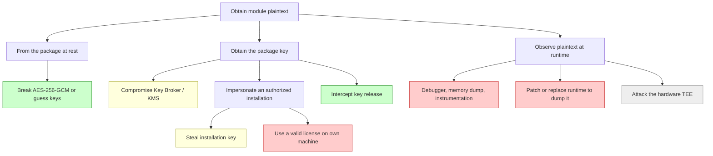

# Threat model (STRIDE)

SERS raises the cost of unauthorized inspection, extraction, tampering and execution and gives enforceable
authorization and integrity controls. It does **not** make reverse engineering impossible. This document
states, per threat, what is actually implemented. "Implemented" means written and covered by a test in the
repository, **not yet compiled or run** (NOT VERIFIED).

## Assets

Protected module plaintext; package keys (KEKs) and DEKs; publisher signing keys; installation private keys;
Control Plane master key and authorization-signing key; license credentials; the audit log; tenant data.

## Trust boundaries and actors

Boundaries: (1) end-user machine (untrusted by definition), (2) network, (3) Control Plane (company-controlled),
(4) KMS/HSM, (5) build/publish pipeline, (6) hardware TEE (when it exists).
Actors: reverse engineer with debugger/instrumentation; malicious local administrator; network attacker; license
pirate (valid or stolen credentials); malicious tenant; compromised publisher or dependency; insider.

## Threats

| ID | STRIDE | Threat | Mitigation today | Residual risk | Test |
|---|---|---|---|---|---|
| T1 | T | Package manifest or module bytes modified | Ed25519 signature over manifest, per-module hashes, AEAD with bound AAD | Compromised publisher key | `tampered_manifest_is_rejected_before_parsing`, `tampered_data_is_caught_by_integrity_and_decryption`, `forged_but_signed_manifests_fail_validation` |
| T2 | S | Package signed by an unknown publisher | Loader / Control Plane trust only registered publisher keys | Publisher key lifecycle (rotation, transparency log) not implemented | `untrusted_publisher_is_rejected`, `package_registration_rejects_untrusted_tampered_and_mismatched_packages` |
| T3 | T | Downgrade to a vulnerable older package | `version_counter` floors in Loader and Control Plane; floor only rises | Local floor lost if loader state is wiped; Control Plane is authoritative | `downgrade_is_rejected_and_floor_never_lowers`, `downgrade_is_blocked_at_registration_and_at_authorization` |
| T4 | D | Malformed or huge package, archive bombs | Single binary container, no compression, hard size limits, parse-after-verify | Whole package held in memory (<= 1 GiB); **no fuzzing yet** | `parser_never_panics_on_garbage`, `bad_magic_and_oversized_manifest_length_are_rejected` |
| T5 | E | Path traversal / symlink via archive entries | No paths in the format; nothing extracted to disk | none known | by construction |
| T6 | I | Plaintext recoverable from the package at rest | AES-256-GCM envelope encryption | See T17 | `plaintext_does_not_appear_in_the_package` |
| T7 | S | Impersonating an installation | Proof of possession at registration; signed challenge | Installation key theft (T20) | `response_signed_by_another_key_is_denied`, `installation_requires_proof_of_possession_and_a_matching_license` |
| T8 | S | Replay of an authorization exchange | Server-side single-use challenge, expiry, binding to app / installation / package | none known | `replayed_response_is_denied`, `expired_challenge_is_denied`, `replayed_response_is_rejected` |
| T9 | T | Altering challenge fields in flight | Signature covers every field | none known | `signature_over_modified_challenge_is_rejected` |
| T10 | I | Interception of the released package key | Sealed to an ephemeral X25519 key authenticated by the signed challenge | **No TLS yet**: no transport confidentiality for metadata; availability attacks | `roundtrip_delivers_the_same_key`, `another_client_key_cannot_open` |
| T11 | S | Stolen or shared license credential | Installation cap per license, revocation, expiry | Attacker can register own installations up to the cap | `license_installation_limit_is_enforced_and_registration_is_idempotent` |
| T12 | R | Actions cannot be traced or are deniable | Hash-chained audit log; secrets excluded | Same party can rewrite the chain; no external append-only sink | `audit_log_is_consistent_and_never_contains_secrets`, audit unit tests |
| T13 | D | Challenge flooding | Only registered active installations get challenges; store bounded | **No rate limiting** (gateway not implemented) | `outstanding_challenges_are_bounded_and_expired_ones_are_purged` |
| T14 | E | Cross-tenant access | Ownership checks on every management operation; globally unique application ids | In-memory only; PostgreSQL RLS written but unverified | `tenants_are_isolated` |
| T15 | E | Revoked party keeps working | Revocation of installation / license / package / application checked before key release | Existing tokens valid until `expires_at` (default 300 s); no push revocation | `revoked_installation_gets_no_challenge_and_no_key`, `license_suspension_revocation_and_expiry_block_authorization`, `revoked_package_and_disabled_application_block_authorization` |
| T16 | I | Secrets in logs or error messages | Static error strings; redacted `Debug`; license credential never audited | General logging not implemented | `debug_hides_secret`, `debug_does_not_leak_key` |
| T17 | I | **Plaintext observed at runtime on an attacker-controlled machine** (debugger, memory dump, Frida, kernel access) | None effective in the software profile. Only a verified hardware TEE could change this, and none is implemented | **High and fundamental**: any machine that is authorized receives the key and the plaintext | Defensive test plan (Ghidra, Frida, GDB, ...) **not executed** |
| T18 | T | Local administrator replaces the runtime or loader | Not implemented (no runtime yet) | High | none |
| T19 | T | Clock rollback to extend an authorization | Not implemented (no runtime enforces tokens) | High | none |
| T20 | I | Theft of the installation private key | 0600 file, owner-only, rejects symlinks and loose modes | Malware as the same user or root reads it; not hardware-backed | `key_file_is_owner_only_and_temp_file_is_removed`, `permissive_mode_is_rejected` |
| T21 | E | Calling the protected core directly after authorization | Not implemented (module ABI and host/core boundary undefined) | High | none |
| T22 | S/T | Compromised publisher signing key | Per-application publisher key sets | No rotation workflow, no transparency log | none |
| T23 | T | Compromised dependency or build | Not implemented (cargo audit/deny, SBOM, signing, provenance) | High | none |
| T24 | E/I | Control Plane or master-key compromise | Master key behind `KeyProvider`; token signer behind `TokenSigner` | Only dev providers exist (keys in process memory) | none |
| T25 | I | TEE vulnerabilities, side channels | N/A: no TEE backend | N/A | none |
| T26 | S | Fake hardware attestation | Verifier interface; shipped verifier never verifies, so `hardware_required` fails closed; client booleans ignored | No real verifier exists | `hardware_required_fails_closed_without_verified_attestation`, `client_claim_without_process_isolation_gets_no_software_grant` |

## Attack tree: obtain protected module plaintext

Reading: cryptography protects the package in transit and at rest and makes key release conditional and auditable.
It does not stop a legitimately authorized user from observing what their own machine decrypts. Only keeping the
sensitive operation off that machine (remote execution) or inside a verified TEE changes this, and the former
trades latency, availability and cost for confidentiality.

## Test plan against analysis tools (not executed)

For each of Ghidra, IDA, Binary Ninja, radare2, Frida, GDB, LLDB, WinDbg and DynamoRIO, in an authorized lab and
once a runtime exists: (1) static: can module plaintext or keys be recovered from the package or the runtime
binary? (2) dynamic: can the decrypted module or the package key be read from process memory or intercepted at
the IPC boundary? (3) tamper: can the runtime be patched to skip authorization or token expiry? Record results
per backend profile. Debugger detection is not treated as protection.
